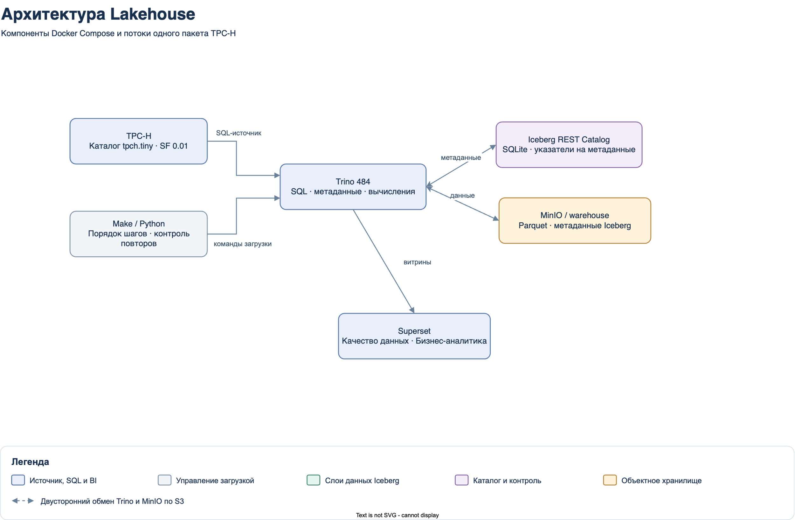
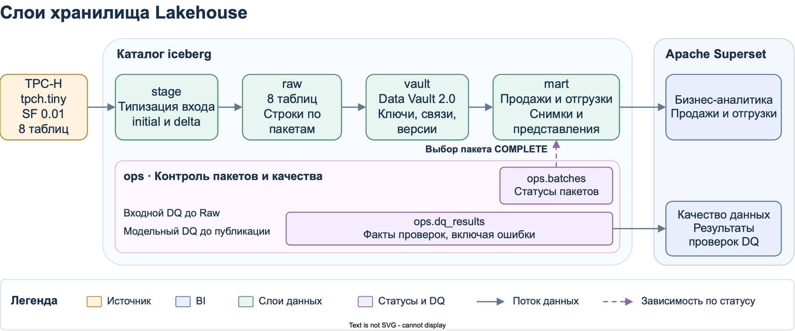
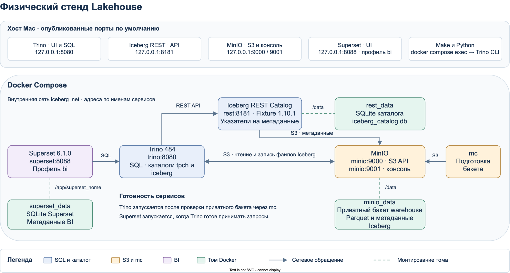

# ПОЯСНИТЕЛЬНАЯ ЗАПИСКА

**Архитектура прототипа**\
**хранилища данных Lakehouse**

Комплект проектной документации к тестовому заданию

ПЗ-ХД-LAKEHOUSE-01

Редакция 1.0 для рассмотрения

25 ноября 2026 г.

## 1 Назначение документа

Пояснительная записка описывает архитектуру прототипа хранилища данных Lakehouse, созданного для тестового задания системного аналитика по данным. Она предназначена для технического рецензирования решения. Записка раскрывает устройство системы, взаимодействие компонентов, основания принятых решений и границы их применимости.

Функциональные требования и критерии приёмки определены в ТЗ-ХД-LAKEHOUSE-01. Схемы таблиц и правила преобразований раскрыты в ТРП и полевой модели, результаты демонстрации — в протоколе приёмки. Роли и архитектурные представления описаны с учётом ГОСТ Р 57100-2025 и ГОСТ Р 59795-2021.

Карточки Росстандарта  [ГОСТ Р 57100-2025](<https://protect.gost.ru/gost/details/9969bbc3-5496-49cd-935a-7ac548ac29de>) · [ГОСТ Р 59795-2021](<https://protect.gost.ru/gost/details/29834ae6-3ac4-4f76-859f-7704ed07f1c8>)

## 2 Обзор решения

Стенд выполняет пакетную загрузку восьми таблиц синтетического источника TPC-H из каталога Trino tpch.tiny. Исходный снимок при SF 0.01 содержит 86 805 строк. Trino типизирует набор, записывает строки в Iceberg Raw, формирует Data Vault 2.0 и рассчитывает две витрины. Файлы Iceberg размещаются в MinIO, а указателями на текущие метаданные управляет Iceberg REST Catalog.

Контрольная дельта показывает сквозное влияние изменения. Скидка в позиции заказа (1, 1) повышается с 0,04 до 0,05. В сателлите появляется вторая версия. В витрине продаж сумма после скидки в регионе ASIA за январь 1996 года уменьшается на 247,1035. Витрина отгрузок сохраняет прежние значения. В Superset бизнес-показатели и результаты проверок размещены на двух вкладках одного дашборда.

## 3 Заинтересованные лица и архитектурные аспекты

Роли ниже описывают сценарии использования и рецензирования прототипа.

Таблица 1 — Заинтересованные лица и их интересы

| Роль | Архитектурный интерес | Материал для проверки |
| --- | --- | --- |
| Ревьюер тестового задания | Воспроизводимость сквозного сценария и связь результата с ТЗ | ПМИ, протокол, ручная инструкция |
| Архитектор платформы данных | Границы компонентов, хранение метаданных, публикация и восстановление | Эта записка, архитектура draw.io, ТРП |
| Разработчик хранилища | Гранулярность, ключи, история, повторная загрузка | Модель данных, DDL, SQL и код загрузки |
| Бизнес-аналитик | Смысл метрик, календарные разрезы и действие фильтров | Бизнес-вкладка Superset и описание витрин |
| Оператор стенда | Запуск и диагностика сервисов, состояние пакета, проверка DQ | Руководство по развёртыванию и DQ-вкладка |

## 4 Архитектурные представления

### 4.1 Контекстное представление

Граница прототипа охватывает локальную рабочую станцию, процесс загрузки и Docker Compose. Оператор из терминала выполняет команды Make. Python вызывает Trino CLI в контейнере и передаёт SQL. Коннектор TPC-H генерирует строки при запросе к tpch.tiny. Подготовка файлов источника и отдельный генератор в Compose не требуются.

Trino обращается к каталогу по REST и к MinIO по S3 API. SQL-потребители обращаются к Trino. Бизнес-пользователь и оператор открывают Superset в браузере. Superset запрашивает опубликованные витрины и факты DQ через Trino по SQLAlchemy с Python-драйвером trino.

Рисунок 1 — Компоненты прототипа и потоки данных · [Исходник draw.io](../diagrams/architecture.drawio)

Внутренние обращения используют DNS-имена сервисов Compose. Порты на Mac опубликованы на 127.0.0.1. На этапе подготовки окружения требуется доступ к удалённым исходникам и реестрам образов. Рабочий набор TPC-H генерируется в стенде и содержит синтетические данные.

Бизнес-вкладка читает только агрегаты завершённого пакета. Вкладка качества читает результаты попыток из Ops, в том числе ошибки диагностического входа. Оператор может исследовать отказ, а потребитель витрин продолжает видеть подтверждённые показатели.

### 4.2 Логическое представление: слои хранилища

Основной поток идёт от типизированного входа через Raw и Data Vault 2.0 к витринам. Ops регистрирует работу загрузки и задаёт границу публикации. Сверка по Raw использует отдельный контрольный расчёт.

Таблица 2 — Слои хранилища и их назначение

| Схема Iceberg | Содержимое | Назначение и гранулярность |
| --- | --- | --- |
| stage | Входные и расчётные SQL-представления | Формирует типизированный initial и одно изменение delta. Подготавливает кандидатов витрин и независимые сверки. |
| raw | Восемь таблиц TPC-H по пакетам | Одна строка на исходный ключ и batch_seq. Сохраняет исходный снимок и события изменений. |
| vault | 6 Hubs, 6 Links, 8 Satellites | Одна запись на бизнес-ключ или связку ролей. Версии атрибутов сателлита хранятся по (hk, batch_seq). |
| mart | sales_snapshot, shipping_snapshot и два опубликованных представления | Одна строка на группу измерений и пакет. Представления отбирают снимки последнего пакета COMPLETE. |
| ops | batches и dq_results | Одна запись на зарегистрированный пакет. Один факт проверки на сочетание run_id, фазы, правила и объекта. |

Рисунок 2 — Слои хранилища · [Исходник draw.io](../diagrams/warehouse-layers.drawio)

Raw сохраняет исходные ключи и значения после приведения типов. Денежные величины, количество и ставки приводятся к DECIMAL. В Vault связи вынесены в Links. Для позиции заказа исходная гранулярность задана парой (orderkey, linenumber). Транзакционный Link хранит номер позиции и роли заказа, товара и поставщика. Сателлиты сохраняют версии атрибутов при изменении hashdiff.

SHA-256 вычисляется по упорядоченному JSON-массиву строковых значений с меткой объекта. В хеш-ключ Links входят исходные ключи по ролям. Для позиции это orderkey, linenumber, partkey и suppkey. В hashdiff входят атрибуты сателлита. JSON различает NULL и пустую строку. Номер пакета, время загрузки и источник обеспечивают трассировку версии.

Продажи группируются по месяцу заказа и региону клиента. В группе считаются уникальные заказы, позиции, сумма extendedprice и сумма extendedprice × (1 − discount) без налога. Отгрузки группируются по месяцу отгрузки и способу доставки. Запоздалой считается позиция с shipdate &gt; commitdate. Доля при укрупнении считается как отношение суммарного числа запоздалых позиций ко всем отгруженным позициям.

Фильтры бизнеса разделены по измерениям. Регион применяется к продажам, способ доставки — к отгрузкам. Один выбор месяца действует на календарь каждой витрины, поэтому один заказ и его отгрузка могут попасть в разные месяцы.

### 4.3 Физическое представление: стенд

Базовый Compose-проект содержит Trino, Iceberg REST Fixture, MinIO и mc. Trino выполняет SQL в одном контейнере. mc создаёт бакет warehouse, отключает анонимный доступ и проходит проверку готовности. Профиль bi добавляет Superset. Make и Python выполняются на хосте.

Таблица 3 — Интерфейсы и состояние компонентов

| Сервис | Адрес в Compose | Порт на Mac¹ | Данные и состояние |
| --- | --- | --- | --- |
| Trino | trino:8080 | 8080 | SQL через HTTP и служебный UI. Каталоги tpch и iceberg. |
| Iceberg REST | rest:8181 | 8181 | Указатели на текущие метаданные в SQLite на томе rest_data. |
| MinIO | minio:9000 / :9001 | 9000 / 9001 | S3 API и консоль. Приватный бакет на томе minio_data. |
| mc | Обращается к minio:9000 | — | Инициализация и проверка доступности бакета. |
| Superset | superset:8088 | 8088 | HTTP UI. SQLite с метаданными BI на томе superset_data. |

¹ Приведены порты по умолчанию. Проекты с другими значениями в .env используют эти же внутренние адреса. Учётные данные MinIO и Superset задаются локально.

Таблицы Raw, Vault, Ops и агрегатные снимки Mart используют Iceberg v2 и Parquet. При SF 0.01 таблицы созданы без физического секционирования. MinIO хранит файлы данных, метаданные Iceberg и манифесты. Постоянные тома сохраняют содержимое при пересоздании контейнеров.

Коммит Iceberg фиксирует состояние отдельной таблицы. Одна загрузка пишет в несколько таблиц последовательными шагами. Общая граница публикации реализована в SQL-представлениях над снимками. Оба представления используют максимальный batch_seq со статусом COMPLETE в ops.batches.

Стенд проверен на Apple M1 Pro с Linux ARM64 в контейнерах. Для сквозной приёмки использован отдельный Compose-проект с чистыми томами. Изоляция проекта позволяет повторить испытания с другими значениями опубликованных портов.

## 5 Обоснование архитектурных решений

Решения приняты для локального воспроизводимого стенда. Их проверяли по сохранности данных, повторяемости загрузки и согласованности показателей.

Таблица 4 — Архитектурные решения и последствия

| Решение | Обоснование | Последствие для прототипа |
| --- | --- | --- |
| Разделить SQL, каталог и объектное хранилище | В одном контуре демонстрируются вычисления Trino, управление таблицами Iceberg через REST и файловое хранение в MinIO. | Пересоздание контейнеров сохраняет данные на томах. Для восстановления нужны и каталог, и файлы бакета. |
| Сохранить события Raw и выделить Data Vault 2.0 | Raw даёт независимый контрольный набор. Hubs и Links сохраняют ключи и связи, Satellites сохраняют изменения атрибутов. | Дельта добавляет новую версию позиции. Для витрины требуется восстановить состояние атрибутов на выбранный пакет. |
| Хранить агрегаты по пакету | Фильтры Superset многократно запрашивают одинаковые бизнес-разрезы. Снимки рассчитываются один раз на этапе загрузки. | BI читает готовые группы. Хранение снимков расходует место, а расчёт выполняется при загрузке. Для публикации нужны оба снимка. |
| Публиковать через статус COMPLETE | Одна загрузка меняет несколько таблиц, а каждая из них фиксируется своим коммитом. | До публикации BI читает прежний пакет. Частичная запись доступна для продолжения загрузки. |
| Разделить входные и модельные DQ | Входные проверки отсеивают ошибочные данные до Raw. Модельные проверяют ключи, ссылки, версии и согласованность агрегатов. | Факты контроля сохраняются отдельно от статуса публикации. Оператор видит также отклонённую попытку. |

Рисунок 3 — Физический стенд · [Исходник draw.io](../diagrams/physical-stand.drawio)

При повторе незавершённой загрузки пакет сохраняет batch_seq и первоначальное время загрузки. MERGE по ключам удерживает состав Raw, Vault и снимков. Новая попытка получает собственный run_id. Входной и модельный контроль дают 33 и 59 результатов для корректного пакета. Публикация требует успешного прохождения обеих фаз.

Во время приёмки остановка после Raw оставила открытым для BI пакет initial. Повтор довёл delta до публикации без дублей. Диагностический вход invalid со скидкой 1,25 остановился на DISCOUNT_RANGE. Результат сохранён в ops.dq_results. Записи пакета в ops.batches, строки Raw и снимки этого входа не создаются. Опубликованные показатели сохранились. Сбой SQLITE_BUSY на техническом прогоне привёл к настройке ожидания блокировки SQLite и ограниченному повтору идемпотентных операций.

## 6 Технологический стек

Таблица 5 — Компоненты технологического стека

| Компонент и версия | Роль в решении | Обоснование выбора |
| --- | --- | --- |
| Docker Compose v5.7.1 | Запуск сервисов, внутренняя сеть и именованные тома | Воспроизводимая конфигурация и изоляция проектом |
| Trino 484 и коннектор TPC-H | SQL, синтетический источник, операции Iceberg | Один интерфейс запросов к источнику, слоям и BI |
| Apache Iceberg v2 и Parquet | Табличный формат и колоночные файлы | Снимки таблиц и коммиты поверх объектного хранилища |
| Iceberg REST Fixture 1.10.1 и SQLite | REST-каталог и хранение указателей | Локальная реализация API с состоянием на одном томе |
| MinIO RELEASE.2025-04-22T22-12-26Z и mc RELEASE.2025-04-16T18-13-26Z | Локальное S3-хранилище и инициализация бакета | Проверка реального пути чтения и записи файлов Iceberg |
| Make и Python 3.9+ | Автоматизация загрузки и проверок | Одни SQL-файлы для автоматического и пошагового запуска |
| Superset 6.1.0 и драйвер trino 0.337.0 | Веб-дашборд и подключение к Trino | Две вкладки для бизнеса и контроля, переносимый ZIP-экспорт |

## 7 Ограничения, допущения и развитие

Прототип использует один синтетический источник SF 0.01, один контейнер Trino и последовательную загрузку. Проверенный набор изменений ограничен атрибутом одной позиции. Удаления, изменение связей, обработка опоздавших событий и параллельные загрузки с разных хостов выходят за пределы демонстрации. Ограничение одновременных запусков реализовано локальной блокировкой по Compose-проекту.

Состояние REST Catalog и Superset хранится в локальных SQLite. Ограничения по конкурентной записи и восстановлению нужно повторно оценить при переходе к нескольким операторам. Протокол подтверждает функциональную приёмку на Mac. Требования к пропускной способности, доступности и параметрам аварийного восстановления для промышленной среды в этом прототипе не проверялись.

Развитие предполагает второй источник с явным согласованием бизнес-ключей, испытания на большем объёме, оценку секционирования и размеров файлов, промышленный каталог и запуск по расписанию. Сравнение конфигураций целесообразно проводить по времени загрузки, запросов BI и восстановления. Контрольные показатели TPC-H остаются регрессионным набором для сверки формул и истории.
