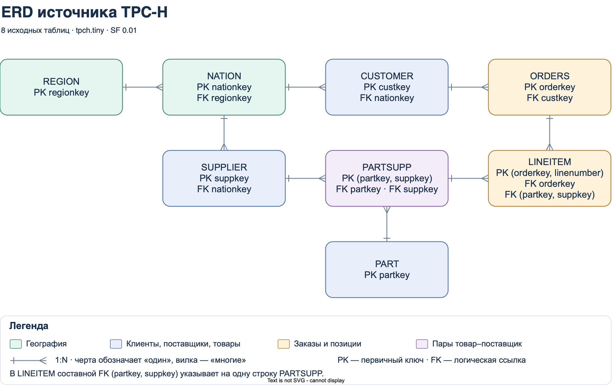
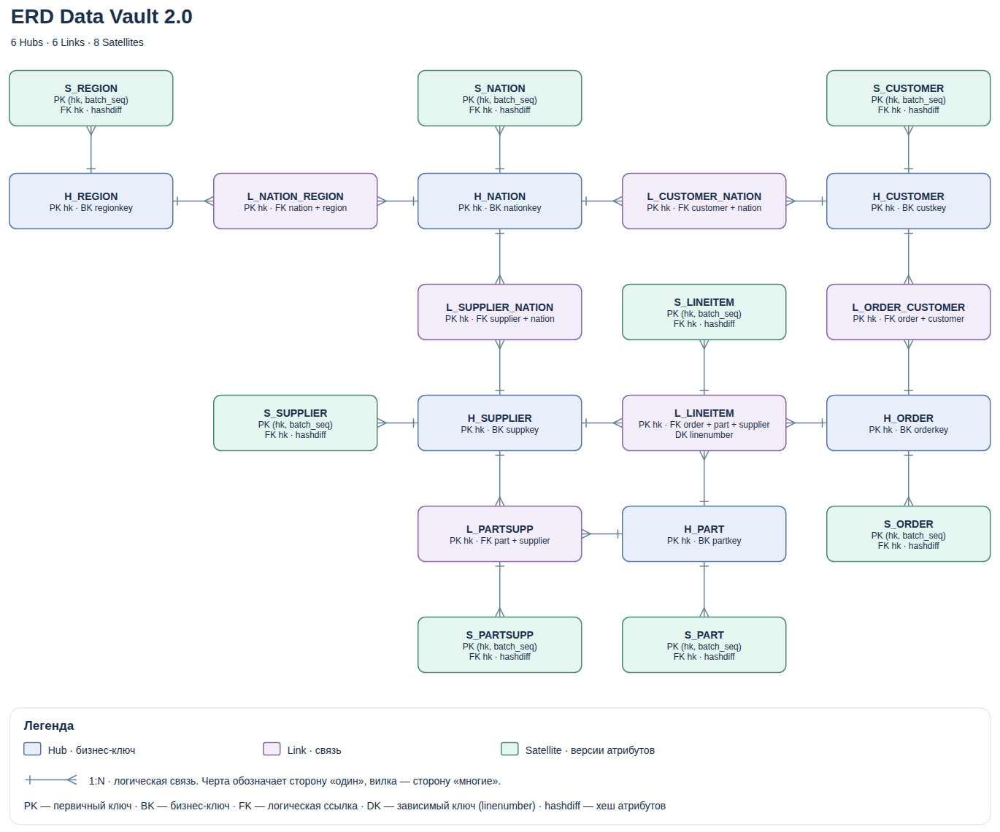

# ОПИСАНИЕ ИНФОРМАЦИОННОГО ОБЕСПЕЧЕНИЯ

**Модель данных прототипа**\
**хранилища Lakehouse**

TPC-H, Data Vault 2.0, витрины и служебные данные

МД-ХД-LAKEHOUSE-01

Редакция 1.0 для рассмотрения

25 ноября 2026 г.

## 1 Назначение документа

Документ описывает модель данных прототипа хранилища Lakehouse от источника TPC-H до Data Vault 2.0 и витрин Superset. Он предназначен для проверки состава таблиц, ключей, типов, происхождения атрибутов и расчётов. Архитектурные границы определены в ПЗ-ХД-LAKEHOUSE-01, критерии приёмки — в ТЗ-ХД-LAKEHOUSE-01.

Разделы 2–5 описывают логическую модель, приложение А содержит фрагменты фактического DDL, приложение Б — полевой словарь и маппинг. Описание подготовлено с учётом ГОСТ Р 59795-2021.

Основания для сверки  [Карточка ГОСТ Р 59795-2021](<https://protect.gost.ru/gost/details/29834ae6-3ac4-4f76-859f-7704ed07f1c8>) · [Протокол приёмки](<https://github.com/ychalyy/trino-iceberg-minio/blob/main/docs/acceptance-results.md>)

## 2 Исходные данные TPC-H

Коннектор Trino формирует синтетические данные при запросе к схеме tpch.tiny. При SF 0.01 исходный снимок содержит 86 805 строк. В пакет initial входят все восемь таблиц. Имена полей в документе соответствуют именам колонок Trino.

Таблица 1 — Состав источника и логические ключи

| Таблица | Одна строка | Строк | Ключ и ссылки |
| --- | --- | --- | --- |
| region | Регион | 5 | regionkey |
| nation | Страна | 25 | nationkey. Ссылка regionkey → region |
| supplier | Поставщик | 100 | suppkey. Ссылка nationkey → nation |
| customer | Клиент | 1 500 | custkey. Ссылка nationkey → nation |
| part | Товар | 2 000 | partkey |
| partsupp | Товар у поставщика | 8 000 | (partkey, suppkey). Ссылки на part и supplier |
| orders | Заказ | 15 000 | orderkey. Ссылка custkey → customer |
| lineitem | Позиция заказа | 60 175 | (orderkey, linenumber). Ссылки на orders и пару (partkey, suppkey) в partsupp |

Заказ может содержать несколько позиций. Номер linenumber имеет смысл внутри заказа. Пара (partkey, suppkey) позиции указывает на конкретное предложение поставщика. Из этой связи проверяется наличие пары, а показатели продаж используют цену позиции extendedprice.

Воспроизводимая delta отбирает первую по (orderkey, linenumber) отгруженную позицию с положительной extendedprice и скидкой не выше 0,99. В подтверждённом наборе это (1, 1). Скидка меняется с 0,04 до 0,05. Диагностический вход invalid подставляет на этой же позиции скидку 1,25.

### 2.1 Связи исходных таблиц



Рисунок 1 — Логическая ERD источника TPC-H

Материалы для сверки  [ERD источника в draw.io](../diagrams/tpch-erd.drawio) · [SQL подготовки TPC-H](<https://github.com/ychalyy/trino-iceberg-minio/blob/main/sql/pipeline/10-source.sql>)

Входной контроль проверяет обязательность и уникальность ключей таблиц, объём пакета и восемь исходных связей. Составная ссылка позиции проверяется по обеим колонкам сразу. В delta остальные строки берутся из начального снимка при восстановлении состояния на пакет.

## 3 Соглашения о моделировании

Таблица 2 — Размещение объектов и слои

| Схема Iceberg | Объекты | Ключевое правило |
| --- | --- | --- |
| stage | 14 SQL-представлений | 8 типизируют вход, 6 восстанавливают позиции и рассчитывают кандидатов и эталонные агрегаты. |
| raw | 8 физических таблиц | Логический ключ источника дополняется batch_seq. |
| vault | 20 физических таблиц | Префиксы h\_, l\_ и s\_. Ключи Hubs и Links — hk. Ключ версии Satellite — (hk, batch_seq). |
| mart | 2 таблицы и 2 представления | Таблицы хранят агрегаты по пакету. Представления читают снимки последнего COMPLETE. |
| ops | 2 физические таблицы | batches хранит состояние пакета. dq_results хранит факты проверок по попыткам. |

Физические таблицы используют Iceberg v2 и Parquet без секционирования в проверенной конфигурации SF 0.01. PK и FK в документе обозначают логические ключи и ссылки. В физическом DDL колонки объявлены без NOT NULL, PK и FK. Обязательность в словаре выражает контракт модели. Входные и модельные DQ проверяют ключи, ссылки и те ограничения атрибутов, которые перечислены в ТРП.

Типизация выполняется в stage. Денежные величины и количество позиции приводятся к DECIMAL(15,2), скидка и налог — к DECIMAL(4,2). Цена позиции в TPC-H дана за всё количество в строке. Ограниченная длина VARCHAR приведена по SQL. Iceberg хранит такие колонки как string и Trino может выводить VARCHAR без длины.

Технические поля Vault включают batch_seq, loaded_at и record_source. Время записи версии берётся из ops.batches.loaded_at, источник — литерал TPC-H. Initial и delta получают batch_seq 1 и 2. Invalid использует 3 на входе и сохраняет только факты DQ. Для попытки проверки создаётся отдельный run_id.

### Хеш-ключи и версии

Для Hubs и Links Trino строит упорядоченный JSON-массив со строковой меткой объекта и значениями ключей. Сначала числовые поля типизируются, затем элементы приводятся к VARCHAR. JSON сохраняет границы элементов, пустые строки и NULL. SHA-256 от UTF-8 представления JSON записывается как шестнадцатеричная строка.

Примеры массива для хеша: \["order","1"\] для H_ORDER и \["lineitem",orderkey,linenumber,partkey,suppkey\] для L_LINEITEM. В массиве L_LINEITEM каждое значение ключа сериализуется строкой. Поля hk_order, hk_part и hk_supplier вычисляются с метками соответствующих Hubs.

Hashdiff вычисляется тем же способом с меткой сателлита и описательными атрибутами в порядке SQL. Пакет, время и источник записи не входят в hashdiff. MERGE вставляет версию по (hk, batch_seq), если хеш отличается от последней версии предыдущих пакетов.

Реализация  [DDL модели](<https://github.com/ychalyy/trino-iceberg-minio/blob/main/sql/pipeline/00-schema.sql>) · [Запись Vault и вычисление хешей](<https://github.com/ychalyy/trino-iceberg-minio/blob/main/sql/pipeline/30-vault.sql>)

## 4 Центральный слой Data Vault 2.0

В схеме vault выделены шесть Hubs, шесть Links и восемь Satellites. ERD показывает 21 логическую ссылку 1:N между Hubs, Links и Satellites. Детализация ключей и полей дана в подразделах 4.1–4.3 и в приложении Б.



Рисунок 2 — Центральный слой Data Vault 2.0 · [Исходник draw.io](../diagrams/data-vault-erd.drawio)

Позиция заказа представлена транзакционным L_LINEITEM. Он хранит зависимый номер позиции и хеш-ключи заказа, товара и поставщика. Изменение скидки сохраняется в S_LINEITEM при прежнем ключе связи.

### 4.1 Хабы

Хаб хранит один бизнес-ключ, его хеш и сведения о первой регистрации. Названия, адреса и другие изменяемые признаки находятся в сателлитах.

Таблица 3 — Хабы центрального слоя

| Хаб | Бизнес-сущность | Бизнес-ключ | Источник |
| --- | --- | --- | --- |
| h_region | Регион | regionkey | raw.region |
| h_nation | Страна | nationkey | raw.nation |
| h_supplier | Поставщик | suppkey | raw.supplier |
| h_customer | Клиент | custkey | raw.customer |
| h_part | Товар | partkey | raw.part |
| h_order | Заказ | orderkey | raw.orders |

### 4.2 Линки

Каждый Link хранит один набор ролей связи. Первичная регистрация фиксируется по hk. Роль хранится как hk связанного хаба, а собственный ключ Link вычисляется от исходных значений ролей в порядке таблицы 4. Для позиции порядок полей включает зависимый номер внутри заказа.

Таблица 4 — Линки центрального слоя

| Линк и источник | Логические ссылки | Порядок исходных ключей в hk |
| --- | --- | --- |
| l_nation_region<br>raw.nation | hk_nation → h_nation<br>hk_region → h_region | nationkey, regionkey |
| l_supplier_nation<br>raw.supplier | hk_supplier → h_supplier<br>hk_nation → h_nation | suppkey, nationkey |
| l_customer_nation<br>raw.customer | hk_customer → h_customer<br>hk_nation → h_nation | custkey, nationkey |
| l_order_customer<br>raw.orders | hk_order → h_order<br>hk_customer → h_customer | orderkey, custkey |
| l_partsupp<br>raw.partsupp | hk_part → h_part<br>hk_supplier → h_supplier | partkey, suppkey |
| l_lineitem<br>raw.lineitem | hk_order → h_order<br>hk_part → h_part<br>hk_supplier → h_supplier | orderkey, linenumber, partkey, suppkey |

У исходной позиции ключ (orderkey, linenumber). Хеш-ключ L_LINEITEM включает и пару ролей товар–поставщик. Демонстрационная delta меняет скидку при неизменных ролях. Модель смены поставщика или товара для существующей позиции выходит за объём проверенного сценария.

### 4.3 Сателлиты

Сателлит хранит версии атрибутов одного родителя. Строка идентифицируется парой (hk, batch_seq). Новый пакет добавляет строку только при изменении hashdiff или при первом появлении ключа. Время окончания версии не хранится. Для позиции на рассматриваемый пакет берётся версия с максимальным batch_seq, не превышающим номер пакета.

Таблица 5 — Сателлиты и состав описательных атрибутов

| Сателлит | Родитель | Поля hashdiff в порядке SQL |
| --- | --- | --- |
| s_region | h_region | name, comment |
| s_nation | h_nation | name, comment |
| s_supplier | h_supplier | name, address, phone, acctbal, comment |
| s_customer | h_customer | name, address, phone, acctbal, mktsegment, comment |
| s_part | h_part | name, mfgr, brand, type, size, container, retailprice, comment |
| s_partsupp | l_partsupp | availqty, supplycost, comment |
| s_order | h_order | orderstatus, totalprice, orderdate, orderpriority, clerk, shippriority, comment |
| s_lineitem | l_lineitem | quantity, extendedprice, discount, tax, returnflag, linestatus, shipdate, commitdate, receiptdate, shipinstruct, shipmode, comment |

Страна клиента или поставщика определяется через Link. В сателлитах клиентов и поставщиков отсутствует поле nationkey. Это сохраняет единое место для связи со страной.

Для позиции (1, 1) проведена сверка двух версий S_LINEITEM. Initial хранит скидку 0,04, delta — 0,05. Состав ключей и отношений сохраняется. Повтор delta не добавляет третью строку, а проверка SAT_VERSION_COUNT ожидает ровно одну новую версию S_LINEITEM в пакете delta и ноль для остальных сателлитов.

Для демонстрации актуальная версия позиции вычисляется отдельно для каждого номера пакета. Присоединяемые данные заказов и регионов в проверенном сценарии имеют одну версию. SQL демонстрации не покрывает произвольные изменения этих справочных атрибутов и связей.

Воспроизведение  [SQL модельных проверок](<https://github.com/ychalyy/trino-iceberg-minio/blob/main/sql/pipeline/60-model-dq.sql>) · [Протокол приёмки](<https://github.com/ychalyy/trino-iceberg-minio/blob/main/docs/acceptance-results.md>)

## 5 Витрины данных

### 5.1 Бизнес-вопросы

Витрина продаж отвечает, как по месяцам и регионам клиентов меняются число заказов, число позиций и сумма до и после скидки. Витрина отгрузок показывает, в какие месяцы и при каких способах доставки выше доля позиций, отгруженных после даты обязательства.

### 5.2 Гранулярность и модель

Таблица 6 — Гранулярность витрин

| Снимок и представление | Гранулярность группы | Источники измерений |
| --- | --- | --- |
| sales_snapshot<br>sales_by_region | Месяц заказа и регион клиента | s_order.orderdate. Регион из s_region.name по связи заказа с клиентом, страной и регионом. |
| shipping_snapshot<br>shipping_by_mode | Месяц отгрузки и способ доставки | s_lineitem.shipdate и s_lineitem.shipmode. Учитываются строки с заполненной shipdate. |

Логический ключ строки снимка дополнительно включает batch_seq. Оба представления выбирают только строки снимка, номер которого равен MAX(batch_seq) со статусом COMPLETE в ops.batches. Для отчёта Superset считывает готовые агрегаты. Вкладка качества читает ops.dq_results отдельно от бизнес-витрин.

### 5.3 Правила расчёта показателей

Таблица 7 — Показатели витрин

| Показатель | Правило | Тип Trino |
| --- | --- | --- |
| orders | COUNT(DISTINCT hk_order) внутри группы | BIGINT |
| line_count | COUNT(\*) позиций в группе продаж | BIGINT |
| gross_sales | SUM(extendedprice) до скидки и налога | DECIMAL(38,2) |
| net_sales | SUM(CAST(extendedprice × (1 − discount) AS DECIMAL(22,4))) без налога | DECIMAL(38,4) |
| shipped_lines | COUNT(\*) позиций с заполненной shipdate | BIGINT |
| late_lines | COUNT_IF(shipdate &gt; commitdate) | BIGINT |
| late_share | CAST(late_lines AS DOUBLE) / shipped_lines | DOUBLE |

При агрегации отгрузок по нескольким месяцам Superset делит SUM(late_lines) на SUM(shipped_lines). Доли отдельных групп не усредняются. Число уникальных заказов относится к группе месяц–регион.

Проверка по независимому SQL из Raw дала ноль расхождений в обеих витринах. В группе ASIA за январь 1996 года net_sales изменился с 4 809 918,9692 на 4 809 671,8657. Разница −247,1035 равна −extendedprice × 0,01. Показатели отгрузок сохранились.

SQL витрин  [Расчёт](<https://github.com/ychalyy/trino-iceberg-minio/blob/main/sql/pipeline/40-marts.sql>) · [Снимки](<https://github.com/ychalyy/trino-iceberg-minio/blob/main/sql/pipeline/45-mart-snapshots.sql>) · [Публикация](<https://github.com/ychalyy/trino-iceberg-minio/blob/main/sql/pipeline/46-public-marts.sql>)

## Приложение А. Примеры DDL центрального слоя

Определения приведены из 00-schema.sql. Перед созданием таблиц скрипт создаёт схему vault в каталоге Iceberg командой CREATE SCHEMA IF NOT EXISTS iceberg.vault.

### А.1 Хаб

```sql
CREATE TABLE IF NOT EXISTS iceberg.vault.h_customer (
    hk varchar,
    custkey bigint,
    batch_seq integer,
    loaded_at timestamp(6) with time zone,
    record_source varchar
) WITH (format = 'PARQUET', format_version = 2);
```

### А.2 Линк и сателлит

```sql
CREATE TABLE IF NOT EXISTS iceberg.vault.l_order_customer (
    hk varchar,
    hk_order varchar,
    hk_customer varchar,
    batch_seq integer,
    loaded_at timestamp(6) with time zone,
    record_source varchar
) WITH (format = 'PARQUET', format_version = 2);
```

```sql
CREATE TABLE IF NOT EXISTS iceberg.vault.s_customer (
    hk varchar,
    hashdiff varchar,
    name varchar(25),
    address varchar(40),
    phone varchar(15),
    acctbal decimal(15,2),
    mktsegment varchar(10),
    comment varchar(117),
    batch_seq integer,
    loaded_at timestamp(6) with time zone,
    record_source varchar
) WITH (format = 'PARQUET', format_version = 2);
```

Полная схема  [DDL таблиц в репозитории](<https://github.com/ychalyy/trino-iceberg-minio/blob/main/sql/pipeline/00-schema.sql>)

## Приложение Б. Словарь данных и маппинг

Словарь охватывает 262 поля 32 таблиц и двух опубликованных представлений. Для восьми объектов Raw также даны типы полей источника. Представления stage описаны в Б.1. PK, FK, BK и DK обозначают первичный логический ключ, логическую ссылку, бизнес-ключ и зависимый ключ. «NULL» показывает допустимость по логическому контракту. Знак «—» в графе ключа обозначает обычный атрибут. Краткие ссылки на h\_, l\_ и s\_ относятся к схеме vault.

### Б.1 Представления подготовки и контроля

Все представления раздела находятся в iceberg.stage. Входные представления до записи Raw используют тот же набор полей и порядок типов, которые указаны в Б.2. Поля Raw читаются из одноимённого представления с фильтром batch_seq на обрабатываемый пакет.

Таблица Б.1 — Состав представлений stage

| Объект | Гранулярность | Поля и маппинг |
| --- | --- | --- |
| region, nation, supplier, customer, part, partsupp, orders | Одна строка источника в initial | Поля и типы совпадают с Raw. batch_seq = 1. |
| lineitem | Одна позиция в номере пакета | Поля Raw. batch_seq = 1 для снимка, 2 для delta, 3 для диагностической строки. |
| raw_positions | Одна актуальная позиция на номер рассматриваемого пакета | Поля raw.lineitem плюс as_of_batch (integer) из ops.batches и version_rank (bigint) из ROW_NUMBER по убыванию batch_seq. В выводе version_rank = 1. |
| vault_positions | Одна актуальная версия сателлита позиции на номер пакета | Поля vault.s_lineitem и два поля как в raw_positions. Ранжирование по (as_of_batch, hk). |
| vault_sales, raw_sales | Один агрегат по пакету, месяцу заказа и региону | Поля совпадают с mart.sales_snapshot. Расчёт по Vault или контрольный SQL по Raw. |
| vault_shipping, raw_shipping | Один агрегат по пакету, месяцу отгрузки и способу | Поля совпадают с mart.shipping_snapshot. Расчёт по Vault или контрольный SQL по Raw. |

Поля as_of_batch и version_rank присутствуют в обеих позиционных витринах подготовки. as_of_batch задаёт состояние на номер пакета, version_rank служит для отбора его последней доступной версии. В остальных расчётных представлениях номер пакета возвращается как batch_seq. Для контрольных справочников Raw берётся initial.

### Б.2 Исходные таблицы и Raw

Исходные поля читаются из одноимённых таблиц tpch.tiny. Если тип источника отличается от типа Raw, в графе «Тип Trino» показано преобразование «источник → Raw». Если указан один тип, он общий. batch_seq добавляется при подготовке входа.

#### raw.region

Один регион в пакете. Ключ источника — regionkey.

| Поле | Тип Trino | Назначение | NULL | Роль в ключе | Источник или правило |
| --- | --- | --- | --- | --- | --- |
| regionkey | bigint | Идентификатор региона | Нет | PK | region.regionkey. |
| name | varchar(25) | Наименование объекта | Да | — | region.name. |
| comment | varchar(152) | Текстовое примечание TPC-H | Да | — | region.comment. |
| batch_seq | integer | Порядковый номер пакета | Нет | PK | 1 для initial, 2 для delta. |

#### raw.nation

Одна страна в пакете. Ключ источника — nationkey.

| Поле | Тип Trino | Назначение | NULL | Роль в ключе | Источник или правило |
| --- | --- | --- | --- | --- | --- |
| nationkey | bigint | Идентификатор страны | Нет | PK | nation.nationkey. |
| name | varchar(25) | Наименование объекта | Да | — | nation.name. |
| regionkey | bigint | Идентификатор региона | Нет | FK → region (regionkey) | nation.regionkey. |
| comment | varchar(152) | Текстовое примечание TPC-H | Да | — | nation.comment. |
| batch_seq | integer | Порядковый номер пакета | Нет | PK | 1 для initial, 2 для delta. |

#### raw.supplier

Один поставщик в пакете. Ключ источника — suppkey.

| Поле | Тип Trino | Назначение | NULL | Роль в ключе | Источник или правило |
| --- | --- | --- | --- | --- | --- |
| suppkey | bigint | Идентификатор поставщика | Нет | PK | supplier.suppkey. |
| name | varchar(25) | Наименование объекта | Да | — | supplier.name. |
| address | varchar(40) | Адрес контрагента | Да | — | supplier.address. |
| nationkey | bigint | Идентификатор страны | Нет | FK → nation (nationkey) | supplier.nationkey. |
| phone | varchar(15) | Номер телефона | Да | — | supplier.phone. |
| acctbal | double →<br>decimal(15,2) | Баланс счёта контрагента | Да | — | supplier.acctbal → CAST AS decimal(15,2). |
| comment | varchar(101) | Текстовое примечание TPC-H | Да | — | supplier.comment. |
| batch_seq | integer | Порядковый номер пакета | Нет | PK | 1 для initial, 2 для delta. |

### Б.2 Исходные таблицы и Raw. Продолжение

#### raw.customer

Один клиент в пакете. Ключ источника — custkey.

| Поле | Тип Trino | Назначение | NULL | Роль в ключе | Источник или правило |
| --- | --- | --- | --- | --- | --- |
| custkey | bigint | Идентификатор клиента | Нет | PK | customer.custkey. |
| name | varchar(25) | Наименование объекта | Да | — | customer.name. |
| address | varchar(40) | Адрес контрагента | Да | — | customer.address. |
| nationkey | bigint | Идентификатор страны | Нет | FK → nation (nationkey) | customer.nationkey. |
| phone | varchar(15) | Номер телефона | Да | — | customer.phone. |
| acctbal | double →<br>decimal(15,2) | Баланс счёта контрагента | Да | — | customer.acctbal → CAST AS decimal(15,2). |
| mktsegment | varchar(10) | Сегмент клиента | Да | — | customer.mktsegment. |
| comment | varchar(117) | Текстовое примечание TPC-H | Да | — | customer.comment. |
| batch_seq | integer | Порядковый номер пакета | Нет | PK | 1 для initial, 2 для delta. |

#### raw.part

Один товар в пакете. Ключ источника — partkey.

| Поле | Тип Trino | Назначение | NULL | Роль в ключе | Источник или правило |
| --- | --- | --- | --- | --- | --- |
| partkey | bigint | Идентификатор товара | Нет | PK | part.partkey. |
| name | varchar(55) | Наименование объекта | Да | — | part.name. |
| mfgr | varchar(25) | Производитель | Да | — | part.mfgr. |
| brand | varchar(10) | Марка товара | Да | — | part.brand. |
| type | varchar(25) | Классификация товара | Да | — | part.type. |
| size | integer | Размер товара | Да | — | part.size. |
| container | varchar(10) | Вид упаковки | Да | — | part.container. |
| retailprice | double →<br>decimal(15,2) | Розничная цена товара | Да | — | part.retailprice → CAST AS decimal(15,2). |
| comment | varchar(23) | Текстовое примечание TPC-H | Да | — | part.comment. |
| batch_seq | integer | Порядковый номер пакета | Нет | PK | 1 для initial, 2 для delta. |

### Б.2 Исходные таблицы и Raw. Поставка и заказ

#### raw.partsupp

Одна пара товар–поставщик в пакете. Ключ источника — partkey, suppkey.

| Поле | Тип Trino | Назначение | NULL | Роль в ключе | Источник или правило |
| --- | --- | --- | --- | --- | --- |
| partkey | bigint | Идентификатор товара | Нет | PK / FK → part (partkey) | partsupp.partkey. |
| suppkey | bigint | Идентификатор поставщика | Нет | PK / FK → supplier (suppkey) | partsupp.suppkey. |
| availqty | integer | Доступное количество у поставщика | Да | — | partsupp.availqty. |
| supplycost | double →<br>decimal(15,2) | Цена поставки единицы | Да | — | partsupp.supplycost → CAST AS decimal(15,2). |
| comment | varchar(199) | Текстовое примечание TPC-H | Да | — | partsupp.comment. |
| batch_seq | integer | Порядковый номер пакета | Нет | PK | 1 для initial, 2 для delta. |

#### raw.orders

Один заказ в пакете. Ключ источника — orderkey.

| Поле | Тип Trino | Назначение | NULL | Роль в ключе | Источник или правило |
| --- | --- | --- | --- | --- | --- |
| orderkey | bigint | Идентификатор заказа | Нет | PK | orders.orderkey. |
| custkey | bigint | Идентификатор клиента | Нет | FK → customer (custkey) | orders.custkey. |
| orderstatus | varchar(1) | Код статуса заказа | Да | — | orders.orderstatus. |
| totalprice | double →<br>decimal(15,2) | Полная цена заказа из TPC-H | Да | — | orders.totalprice → CAST AS decimal(15,2). |
| orderdate | date | Дата заказа | Да | — | orders.orderdate. |
| orderpriority | varchar(15) | Приоритет заказа | Да | — | orders.orderpriority. |
| clerk | varchar(15) | Код сотрудника | Да | — | orders.clerk. |
| shippriority | integer | Приоритет отгрузки | Да | — | orders.shippriority. |
| comment | varchar(79) | Текстовое примечание TPC-H | Да | — | orders.comment. |
| batch_seq | integer | Порядковый номер пакета | Нет | PK | 1 для initial, 2 для delta. |

### Б.2 Исходные таблицы и Raw. Позиции заказов

#### raw.lineitem

Одна позиция заказа в пакете. Ключ источника — orderkey, linenumber.

| Поле | Тип Trino | Назначение | NULL | Роль в ключе | Источник или правило |
| --- | --- | --- | --- | --- | --- |
| orderkey | bigint | Идентификатор заказа | Нет | PK / FK → orders (orderkey) | lineitem.orderkey. |
| partkey | bigint | Идентификатор товара | Нет | FK → partsupp (partkey, suppkey) | lineitem.partkey. |
| suppkey | bigint | Идентификатор поставщика | Нет | FK → partsupp (partkey, suppkey) | lineitem.suppkey. |
| linenumber | integer | Номер позиции внутри заказа | Нет | PK | lineitem.linenumber. |
| quantity | double →<br>decimal(15,2) | Количество единиц в позиции | Да | — | lineitem.quantity → CAST AS decimal(15,2). |
| extendedprice | double →<br>decimal(15,2) | Стоимость позиции до скидки и налога | Да | — | lineitem.extendedprice → CAST AS decimal(15,2). |
| discount | double →<br>decimal(4,2) | Ставка скидки как доля единицы | Нет | — | lineitem.discount → CAST AS decimal(4,2). В delta увеличить на 0.01 для выбранной строки. |
| tax | double →<br>decimal(4,2) | Ставка налога как доля единицы | Да | — | lineitem.tax → CAST AS decimal(4,2). |
| returnflag | varchar(1) | Признак возврата позиции | Да | — | lineitem.returnflag. |
| linestatus | varchar(1) | Код состояния позиции | Да | — | lineitem.linestatus. |
| shipdate | date | Дата фактической отгрузки | Да | — | lineitem.shipdate. |
| commitdate | date | Дата обязательства по отгрузке | Да | — | lineitem.commitdate. |
| receiptdate | date | Дата получения | Да | — | lineitem.receiptdate. |
| shipinstruct | varchar(25) | Инструкция для отгрузки | Да | — | lineitem.shipinstruct. |
| shipmode | varchar(10) | Способ доставки | Да | — | lineitem.shipmode. |
| comment | varchar(44) | Текстовое примечание TPC-H | Да | — | lineitem.comment. |
| batch_seq | integer | Порядковый номер пакета | Нет | PK | 1 для initial, 2 для delta. |

### Б.3 Хабы Data Vault 2.0

#### vault.h_region

Один бизнес-ключ из raw.region.

| Поле | Тип Trino | Назначение | NULL | Роль в ключе | Источник или правило |
| --- | --- | --- | --- | --- | --- |
| hk | varchar | Хеш-ключ записи | Нет | PK | SHA-256 пространства region и raw.region.regionkey. |
| regionkey | bigint | Идентификатор региона | Нет | BK | raw.region.regionkey. |
| batch_seq | integer | Порядковый номер пакета | Нет | FK → ops.batches | Номер пакета строки Raw. |
| loaded_at | timestamp(6)<br>with time zone | Время регистрации пакета | Нет | — | ops.batches.loaded_at по batch_seq. |
| record_source | varchar | Исходный набор данных | Нет | — | Константа TPC-H. |

#### vault.h_nation

Один бизнес-ключ из raw.nation.

| Поле | Тип Trino | Назначение | NULL | Роль в ключе | Источник или правило |
| --- | --- | --- | --- | --- | --- |
| hk | varchar | Хеш-ключ записи | Нет | PK | SHA-256 пространства nation и raw.nation.nationkey. |
| nationkey | bigint | Идентификатор страны | Нет | BK | raw.nation.nationkey. |
| batch_seq | integer | Порядковый номер пакета | Нет | FK → ops.batches | Номер пакета строки Raw. |
| loaded_at | timestamp(6)<br>with time zone | Время регистрации пакета | Нет | — | ops.batches.loaded_at по batch_seq. |
| record_source | varchar | Исходный набор данных | Нет | — | Константа TPC-H. |

#### vault.h_supplier

Один бизнес-ключ из raw.supplier.

| Поле | Тип Trino | Назначение | NULL | Роль в ключе | Источник или правило |
| --- | --- | --- | --- | --- | --- |
| hk | varchar | Хеш-ключ записи | Нет | PK | SHA-256 пространства supplier и raw.supplier.suppkey. |
| suppkey | bigint | Идентификатор поставщика | Нет | BK | raw.supplier.suppkey. |
| batch_seq | integer | Порядковый номер пакета | Нет | FK → ops.batches | Номер пакета строки Raw. |
| loaded_at | timestamp(6)<br>with time zone | Время регистрации пакета | Нет | — | ops.batches.loaded_at по batch_seq. |
| record_source | varchar | Исходный набор данных | Нет | — | Константа TPC-H. |

### Б.3 Хабы Data Vault 2.0. Продолжение

#### vault.h_customer

Один бизнес-ключ из raw.customer.

| Поле | Тип Trino | Назначение | NULL | Роль в ключе | Источник или правило |
| --- | --- | --- | --- | --- | --- |
| hk | varchar | Хеш-ключ записи | Нет | PK | SHA-256 пространства customer и raw.customer.custkey. |
| custkey | bigint | Идентификатор клиента | Нет | BK | raw.customer.custkey. |
| batch_seq | integer | Порядковый номер пакета | Нет | FK → ops.batches | Номер пакета строки Raw. |
| loaded_at | timestamp(6)<br>with time zone | Время регистрации пакета | Нет | — | ops.batches.loaded_at по batch_seq. |
| record_source | varchar | Исходный набор данных | Нет | — | Константа TPC-H. |

#### vault.h_part

Один бизнес-ключ из raw.part.

| Поле | Тип Trino | Назначение | NULL | Роль в ключе | Источник или правило |
| --- | --- | --- | --- | --- | --- |
| hk | varchar | Хеш-ключ записи | Нет | PK | SHA-256 пространства part и raw.part.partkey. |
| partkey | bigint | Идентификатор товара | Нет | BK | raw.part.partkey. |
| batch_seq | integer | Порядковый номер пакета | Нет | FK → ops.batches | Номер пакета строки Raw. |
| loaded_at | timestamp(6)<br>with time zone | Время регистрации пакета | Нет | — | ops.batches.loaded_at по batch_seq. |
| record_source | varchar | Исходный набор данных | Нет | — | Константа TPC-H. |

#### vault.h_order

Один бизнес-ключ из raw.orders.

| Поле | Тип Trino | Назначение | NULL | Роль в ключе | Источник или правило |
| --- | --- | --- | --- | --- | --- |
| hk | varchar | Хеш-ключ записи | Нет | PK | SHA-256 пространства order и raw.orders.orderkey. |
| orderkey | bigint | Идентификатор заказа | Нет | BK | raw.orders.orderkey. |
| batch_seq | integer | Порядковый номер пакета | Нет | FK → ops.batches | Номер пакета строки Raw. |
| loaded_at | timestamp(6)<br>with time zone | Время регистрации пакета | Нет | — | ops.batches.loaded_at по batch_seq. |
| record_source | varchar | Исходный набор данных | Нет | — | Константа TPC-H. |

### Б.4 Линки Data Vault 2.0

#### vault.l_nation_region

Одна комбинация ключей nationkey, regionkey.

| Поле | Тип Trino | Назначение | NULL | Роль в ключе | Источник или правило |
| --- | --- | --- | --- | --- | --- |
| hk | varchar | Хеш-ключ записи | Нет | PK | SHA-256 пространства nation_region и полей Raw nationkey, regionkey. |
| hk_nation | varchar | Хеш-ключ хаба nation | Нет | FK → h_nation | Хеш бизнес-ключа роли nation из raw.nation. |
| hk_region | varchar | Хеш-ключ хаба region | Нет | FK → h_region | Хеш бизнес-ключа роли region из raw.nation. |
| batch_seq | integer | Порядковый номер пакета | Нет | FK → ops.batches | Номер пакета строки Raw. |
| loaded_at | timestamp(6)<br>with time zone | Время регистрации пакета | Нет | — | ops.batches.loaded_at по batch_seq. |
| record_source | varchar | Исходный набор данных | Нет | — | Константа TPC-H. |

#### vault.l_supplier_nation

Одна комбинация ключей suppkey, nationkey.

| Поле | Тип Trino | Назначение | NULL | Роль в ключе | Источник или правило |
| --- | --- | --- | --- | --- | --- |
| hk | varchar | Хеш-ключ записи | Нет | PK | SHA-256 пространства supplier_nation и полей Raw suppkey, nationkey. |
| hk_supplier | varchar | Хеш-ключ хаба supplier | Нет | FK → h_supplier | Хеш бизнес-ключа роли supplier из raw.supplier. |
| hk_nation | varchar | Хеш-ключ хаба nation | Нет | FK → h_nation | Хеш бизнес-ключа роли nation из raw.supplier. |
| batch_seq | integer | Порядковый номер пакета | Нет | FK → ops.batches | Номер пакета строки Raw. |
| loaded_at | timestamp(6)<br>with time zone | Время регистрации пакета | Нет | — | ops.batches.loaded_at по batch_seq. |
| record_source | varchar | Исходный набор данных | Нет | — | Константа TPC-H. |

### Б.4 Линки Data Vault 2.0. Продолжение

#### vault.l_customer_nation

Одна комбинация ключей custkey, nationkey.

| Поле | Тип Trino | Назначение | NULL | Роль в ключе | Источник или правило |
| --- | --- | --- | --- | --- | --- |
| hk | varchar | Хеш-ключ записи | Нет | PK | SHA-256 пространства customer_nation и полей Raw custkey, nationkey. |
| hk_customer | varchar | Хеш-ключ хаба customer | Нет | FK → h_customer | Хеш бизнес-ключа роли customer из raw.customer. |
| hk_nation | varchar | Хеш-ключ хаба nation | Нет | FK → h_nation | Хеш бизнес-ключа роли nation из raw.customer. |
| batch_seq | integer | Порядковый номер пакета | Нет | FK → ops.batches | Номер пакета строки Raw. |
| loaded_at | timestamp(6)<br>with time zone | Время регистрации пакета | Нет | — | ops.batches.loaded_at по batch_seq. |
| record_source | varchar | Исходный набор данных | Нет | — | Константа TPC-H. |

#### vault.l_order_customer

Одна комбинация ключей orderkey, custkey.

| Поле | Тип Trino | Назначение | NULL | Роль в ключе | Источник или правило |
| --- | --- | --- | --- | --- | --- |
| hk | varchar | Хеш-ключ записи | Нет | PK | SHA-256 пространства order_customer и полей Raw orderkey, custkey. |
| hk_order | varchar | Хеш-ключ хаба order | Нет | FK → h_order | Хеш бизнес-ключа роли order из raw.orders. |
| hk_customer | varchar | Хеш-ключ хаба customer | Нет | FK → h_customer | Хеш бизнес-ключа роли customer из raw.orders. |
| batch_seq | integer | Порядковый номер пакета | Нет | FK → ops.batches | Номер пакета строки Raw. |
| loaded_at | timestamp(6)<br>with time zone | Время регистрации пакета | Нет | — | ops.batches.loaded_at по batch_seq. |
| record_source | varchar | Исходный набор данных | Нет | — | Константа TPC-H. |

### Б.4 Линки Data Vault 2.0. Товар и позиция заказа

#### vault.l_partsupp

Одна комбинация ключей partkey, suppkey.

| Поле | Тип Trino | Назначение | NULL | Роль в ключе | Источник или правило |
| --- | --- | --- | --- | --- | --- |
| hk | varchar | Хеш-ключ записи | Нет | PK | SHA-256 пространства partsupp и полей Raw partkey, suppkey. |
| hk_part | varchar | Хеш-ключ хаба part | Нет | FK → h_part | Хеш бизнес-ключа роли part из raw.partsupp. |
| hk_supplier | varchar | Хеш-ключ хаба supplier | Нет | FK → h_supplier | Хеш бизнес-ключа роли supplier из raw.partsupp. |
| batch_seq | integer | Порядковый номер пакета | Нет | FK → ops.batches | Номер пакета строки Raw. |
| loaded_at | timestamp(6)<br>with time zone | Время регистрации пакета | Нет | — | ops.batches.loaded_at по batch_seq. |
| record_source | varchar | Исходный набор данных | Нет | — | Константа TPC-H. |

#### vault.l_lineitem

Одна позиция заказа с выбранной парой товар–поставщик.

| Поле | Тип Trino | Назначение | NULL | Роль в ключе | Источник или правило |
| --- | --- | --- | --- | --- | --- |
| hk | varchar | Хеш-ключ записи | Нет | PK | SHA-256 пространства lineitem и полей Raw orderkey, linenumber, partkey, suppkey. |
| hk_order | varchar | Хеш-ключ хаба order | Нет | FK → h_order | Хеш бизнес-ключа роли order из raw.lineitem. |
| hk_part | varchar | Хеш-ключ хаба part | Нет | FK → h_part | Хеш бизнес-ключа роли part из raw.lineitem. |
| hk_supplier | varchar | Хеш-ключ хаба supplier | Нет | FK → h_supplier | Хеш бизнес-ключа роли supplier из raw.lineitem. |
| linenumber | integer | Номер позиции внутри заказа | Нет | DK | raw.lineitem.linenumber. |
| batch_seq | integer | Порядковый номер пакета | Нет | FK → ops.batches | Номер пакета строки Raw. |
| loaded_at | timestamp(6)<br>with time zone | Время регистрации пакета | Нет | — | ops.batches.loaded_at по batch_seq. |
| record_source | varchar | Исходный набор данных | Нет | — | Константа TPC-H. |

### Б.5 Сателлиты Data Vault 2.0. География

#### vault.s_region

Одна изменившаяся версия атрибутов родителя в пакете.

| Поле | Тип Trino | Назначение | NULL | Роль в ключе | Источник или правило |
| --- | --- | --- | --- | --- | --- |
| hk | varchar | Хеш-ключ родителя | Нет | PK / FK → h_region | Хеш родительского vault.h_region.hk из бизнес-ключей Raw. |
| hashdiff | varchar | Хеш бизнес-атрибутов сателлита | Нет | — | SHA-256 упорядоченных атрибутов: name, comment. |
| name | varchar(25) | Наименование объекта | Да | — | raw.region.name. |
| comment | varchar(152) | Текстовое примечание TPC-H | Да | — | raw.region.comment. |
| batch_seq | integer | Порядковый номер пакета | Нет | PK / FK → ops.batches | Номер пакета строки Raw. |
| loaded_at | timestamp(6)<br>with time zone | Время регистрации пакета | Нет | — | ops.batches.loaded_at по batch_seq. |
| record_source | varchar | Исходный набор данных | Нет | — | Константа TPC-H. |

#### vault.s_nation

Одна изменившаяся версия атрибутов родителя в пакете.

| Поле | Тип Trino | Назначение | NULL | Роль в ключе | Источник или правило |
| --- | --- | --- | --- | --- | --- |
| hk | varchar | Хеш-ключ родителя | Нет | PK / FK → h_nation | Хеш родительского vault.h_nation.hk из бизнес-ключей Raw. |
| hashdiff | varchar | Хеш бизнес-атрибутов сателлита | Нет | — | SHA-256 упорядоченных атрибутов: name, comment. |
| name | varchar(25) | Наименование объекта | Да | — | raw.nation.name. |
| comment | varchar(152) | Текстовое примечание TPC-H | Да | — | raw.nation.comment. |
| batch_seq | integer | Порядковый номер пакета | Нет | PK / FK → ops.batches | Номер пакета строки Raw. |
| loaded_at | timestamp(6)<br>with time zone | Время регистрации пакета | Нет | — | ops.batches.loaded_at по batch_seq. |
| record_source | varchar | Исходный набор данных | Нет | — | Константа TPC-H. |

### Б.5 Сателлиты Data Vault 2.0. Контрагенты

#### vault.s_supplier

Одна изменившаяся версия атрибутов родителя в пакете.

| Поле | Тип Trino | Назначение | NULL | Роль в ключе | Источник или правило |
| --- | --- | --- | --- | --- | --- |
| hk | varchar | Хеш-ключ родителя | Нет | PK / FK → h_supplier | Хеш родительского vault.h_supplier.hk из бизнес-ключей Raw. |
| hashdiff | varchar | Хеш бизнес-атрибутов сателлита | Нет | — | SHA-256 упорядоченных атрибутов: name, address, phone, acctbal, comment. |
| name | varchar(25) | Наименование объекта | Да | — | raw.supplier.name. |
| address | varchar(40) | Адрес контрагента | Да | — | raw.supplier.address. |
| phone | varchar(15) | Номер телефона | Да | — | raw.supplier.phone. |
| acctbal | decimal(15,2) | Баланс счёта контрагента | Да | — | raw.supplier.acctbal. |
| comment | varchar(101) | Текстовое примечание TPC-H | Да | — | raw.supplier.comment. |
| batch_seq | integer | Порядковый номер пакета | Нет | PK / FK → ops.batches | Номер пакета строки Raw. |
| loaded_at | timestamp(6)<br>with time zone | Время регистрации пакета | Нет | — | ops.batches.loaded_at по batch_seq. |
| record_source | varchar | Исходный набор данных | Нет | — | Константа TPC-H. |

#### vault.s_customer

Одна изменившаяся версия атрибутов родителя в пакете.

| Поле | Тип Trino | Назначение | NULL | Роль в ключе | Источник или правило |
| --- | --- | --- | --- | --- | --- |
| hk | varchar | Хеш-ключ родителя | Нет | PK / FK → h_customer | Хеш родительского vault.h_customer.hk из бизнес-ключей Raw. |
| hashdiff | varchar | Хеш бизнес-атрибутов сателлита | Нет | — | SHA-256 упорядоченных атрибутов: name, address, phone, acctbal, mktsegment, comment. |
| name | varchar(25) | Наименование объекта | Да | — | raw.customer.name. |
| address | varchar(40) | Адрес контрагента | Да | — | raw.customer.address. |
| phone | varchar(15) | Номер телефона | Да | — | raw.customer.phone. |
| acctbal | decimal(15,2) | Баланс счёта контрагента | Да | — | raw.customer.acctbal. |
| mktsegment | varchar(10) | Сегмент клиента | Да | — | raw.customer.mktsegment. |
| comment | varchar(117) | Текстовое примечание TPC-H | Да | — | raw.customer.comment. |
| batch_seq | integer | Порядковый номер пакета | Нет | PK / FK → ops.batches | Номер пакета строки Raw. |
| loaded_at | timestamp(6)<br>with time zone | Время регистрации пакета | Нет | — | ops.batches.loaded_at по batch_seq. |
| record_source | varchar | Исходный набор данных | Нет | — | Константа TPC-H. |

### Б.5 Сателлиты Data Vault 2.0. Товар и поставка

#### vault.s_part

Одна изменившаяся версия атрибутов родителя в пакете.

| Поле | Тип Trino | Назначение | NULL | Роль в ключе | Источник или правило |
| --- | --- | --- | --- | --- | --- |
| hk | varchar | Хеш-ключ родителя | Нет | PK / FK → h_part | Хеш родительского vault.h_part.hk из бизнес-ключей Raw. |
| hashdiff | varchar | Хеш бизнес-атрибутов сателлита | Нет | — | SHA-256 упорядоченных атрибутов: name, mfgr, brand, type, size, container, retailprice, comment. |
| name | varchar(55) | Наименование объекта | Да | — | raw.part.name. |
| mfgr | varchar(25) | Производитель | Да | — | raw.part.mfgr. |
| brand | varchar(10) | Марка товара | Да | — | raw.part.brand. |
| type | varchar(25) | Классификация товара | Да | — | raw.part.type. |
| size | integer | Размер товара | Да | — | raw.part.size. |
| container | varchar(10) | Вид упаковки | Да | — | raw.part.container. |
| retailprice | decimal(15,2) | Розничная цена товара | Да | — | raw.part.retailprice. |
| comment | varchar(23) | Текстовое примечание TPC-H | Да | — | raw.part.comment. |
| batch_seq | integer | Порядковый номер пакета | Нет | PK / FK → ops.batches | Номер пакета строки Raw. |
| loaded_at | timestamp(6)<br>with time zone | Время регистрации пакета | Нет | — | ops.batches.loaded_at по batch_seq. |
| record_source | varchar | Исходный набор данных | Нет | — | Константа TPC-H. |

#### vault.s_partsupp

Одна изменившаяся версия атрибутов родителя в пакете.

| Поле | Тип Trino | Назначение | NULL | Роль в ключе | Источник или правило |
| --- | --- | --- | --- | --- | --- |
| hk | varchar | Хеш-ключ родителя | Нет | PK / FK → l_partsupp | Хеш родительского vault.l_partsupp.hk из бизнес-ключей Raw. |
| hashdiff | varchar | Хеш бизнес-атрибутов сателлита | Нет | — | SHA-256 упорядоченных атрибутов: availqty, supplycost, comment. |
| availqty | integer | Доступное количество у поставщика | Да | — | raw.partsupp.availqty. |
| supplycost | decimal(15,2) | Цена поставки единицы | Да | — | raw.partsupp.supplycost. |
| comment | varchar(199) | Текстовое примечание TPC-H | Да | — | raw.partsupp.comment. |
| batch_seq | integer | Порядковый номер пакета | Нет | PK / FK → ops.batches | Номер пакета строки Raw. |
| loaded_at | timestamp(6)<br>with time zone | Время регистрации пакета | Нет | — | ops.batches.loaded_at по batch_seq. |
| record_source | varchar | Исходный набор данных | Нет | — | Константа TPC-H. |

### Б.5 Сателлиты Data Vault 2.0. Заказ

#### vault.s_order

Одна изменившаяся версия атрибутов родителя в пакете.

| Поле | Тип Trino | Назначение | NULL | Роль в ключе | Источник или правило |
| --- | --- | --- | --- | --- | --- |
| hk | varchar | Хеш-ключ родителя | Нет | PK / FK → h_order | Хеш родительского vault.h_order.hk из бизнес-ключей Raw. |
| hashdiff | varchar | Хеш бизнес-атрибутов сателлита | Нет | — | SHA-256 упорядоченных атрибутов: orderstatus, totalprice, orderdate, orderpriority, clerk, shippriority, comment. |
| orderstatus | varchar(1) | Код статуса заказа | Да | — | raw.orders.orderstatus. |
| totalprice | decimal(15,2) | Полная цена заказа из TPC-H | Да | — | raw.orders.totalprice. |
| orderdate | date | Дата заказа | Да | — | raw.orders.orderdate. |
| orderpriority | varchar(15) | Приоритет заказа | Да | — | raw.orders.orderpriority. |
| clerk | varchar(15) | Код сотрудника | Да | — | raw.orders.clerk. |
| shippriority | integer | Приоритет отгрузки | Да | — | raw.orders.shippriority. |
| comment | varchar(79) | Текстовое примечание TPC-H | Да | — | raw.orders.comment. |
| batch_seq | integer | Порядковый номер пакета | Нет | PK / FK → ops.batches | Номер пакета строки Raw. |
| loaded_at | timestamp(6)<br>with time zone | Время регистрации пакета | Нет | — | ops.batches.loaded_at по batch_seq. |
| record_source | varchar | Исходный набор данных | Нет | — | Константа TPC-H. |

### Б.5 Сателлиты Data Vault 2.0. Позиция заказа

#### vault.s_lineitem

Одна изменившаяся версия атрибутов родителя в пакете.

| Поле | Тип Trino | Назначение | NULL | Роль в ключе | Источник или правило |
| --- | --- | --- | --- | --- | --- |
| hk | varchar | Хеш-ключ родителя | Нет | PK / FK → l_lineitem | Хеш родительского vault.l_lineitem.hk из бизнес-ключей Raw. |
| hashdiff | varchar | Хеш бизнес-атрибутов сателлита | Нет | — | SHA-256 упорядоченных атрибутов: quantity, extendedprice, discount, tax, returnflag, linestatus, shipdate, commitdate, receiptdate, shipinstruct, shipmode, comment. |
| quantity | decimal(15,2) | Количество единиц в позиции | Да | — | raw.lineitem.quantity. |
| extendedprice | decimal(15,2) | Стоимость позиции до скидки и налога | Да | — | raw.lineitem.extendedprice. |
| discount | decimal(4,2) | Ставка скидки как доля единицы | Нет | — | raw.lineitem.discount. |
| tax | decimal(4,2) | Ставка налога как доля единицы | Да | — | raw.lineitem.tax. |
| returnflag | varchar(1) | Признак возврата позиции | Да | — | raw.lineitem.returnflag. |
| linestatus | varchar(1) | Код состояния позиции | Да | — | raw.lineitem.linestatus. |
| shipdate | date | Дата фактической отгрузки | Да | — | raw.lineitem.shipdate. |
| commitdate | date | Дата обязательства по отгрузке | Да | — | raw.lineitem.commitdate. |
| receiptdate | date | Дата получения | Да | — | raw.lineitem.receiptdate. |
| shipinstruct | varchar(25) | Инструкция для отгрузки | Да | — | raw.lineitem.shipinstruct. |
| shipmode | varchar(10) | Способ доставки | Да | — | raw.lineitem.shipmode. |
| comment | varchar(44) | Текстовое примечание TPC-H | Да | — | raw.lineitem.comment. |
| batch_seq | integer | Порядковый номер пакета | Нет | PK / FK → ops.batches | Номер пакета строки Raw. |
| loaded_at | timestamp(6)<br>with time zone | Время регистрации пакета | Нет | — | ops.batches.loaded_at по batch_seq. |
| record_source | varchar | Исходный набор данных | Нет | — | Константа TPC-H. |

### Б.6 Служебные таблицы

#### ops.batches

Один зарегистрированный пакет.

| Поле | Тип Trino | Назначение | NULL | Роль в ключе | Источник или правило |
| --- | --- | --- | --- | --- | --- |
| batch_seq | integer | Порядковый номер пакета | Нет | PK | 1 для initial, 2 для delta. |
| batch_id | varchar | Имя пакета | Нет | — | Имя пакета из интерфейса загрузки. |
| loaded_at | timestamp(6)<br>with time zone | Время регистрации пакета | Нет | — | current_timestamp(6) при регистрации пакета. |
| status | varchar | Состояние пакета | Нет | — | PENDING при регистрации, COMPLETE после проверок. |

#### ops.dq_results

Один результат правила на объект в фазе и попытке.

| Поле | Тип Trino | Назначение | NULL | Роль в ключе | Источник или правило |
| --- | --- | --- | --- | --- | --- |
| run_id | varchar | Идентификатор попытки | Нет | PK | UUID или ручной идентификатор. |
| batch_id | varchar | Имя пакета | Нет | — | Имя пакета, включая диагностический invalid. |
| checked_at | timestamp(6)<br>with time zone | Время вычисления проверки | Нет | — | current_timestamp(6) при записи группы проверок. |
| phase | varchar | Фаза проверки | Нет | PK | input перед Raw, model перед публикацией. |
| rule_id | varchar | Код правила | Нет | PK | Литерал из SQL DQ. |
| object_name | varchar | Проверяемый объект | Нет | PK | Литерал из SQL DQ. |
| expected_value | bigint | Ожидаемое числовое значение | Нет | — | Ноль нарушений или число строк по источнику. |
| actual_value | bigint | Фактическое числовое значение | Нет | — | Число строк, нарушений или несовпавших групп. |
| violations | bigint | Абсолютное отклонение от ожидаемого | Нет | — | abs(actual_value - expected_value). |
| status | varchar | Результат правила | Нет | — | PASS при равенстве, иначе FAIL. |

### Б.7 Витрины и снимки. Продажи

#### mart.sales_snapshot

Один агрегат на пакет, месяц заказа и регион клиента.

| Поле | Тип Trino | Назначение | NULL | Роль в ключе | Источник или правило |
| --- | --- | --- | --- | --- | --- |
| batch_seq | integer | Порядковый номер пакета | Нет | PK / FK → ops.batches | Номер обрабатываемого пакета. |
| order_month | date | Первый день месяца заказа | Нет | PK | date\_trunc('month', s\_order.orderdate). |
| customer_region | varchar | Регион страны клиента | Нет | PK | s_region.name по цепочке заказ → клиент → страна → регион. |
| orders | bigint | Число уникальных заказов с позициями | Нет | — | count(DISTINCT l_lineitem.hk_order). |
| line_count | bigint | Число позиций заказа | Нет | — | count(\*) на уровне позиции. |
| gross_sales | decimal(38,2) | Сумма стоимости до скидки и налога | Нет | — | SUM(extendedprice) из s_lineitem. |
| net_sales | decimal(38,4) | Сумма стоимости после скидки без налога | Нет | — | sum(CAST(extendedprice \* (1.00 - discount) AS decimal(22,4))). |

#### mart.sales_by_region

Один месяц заказа и регион клиента.

| Поле | Тип Trino | Назначение | NULL | Роль в ключе | Источник или правило |
| --- | --- | --- | --- | --- | --- |
| batch_seq | integer | Порядковый номер пакета | Нет | — | Максимальный COMPLETE в ops.batches. |
| order_month | date | Первый день месяца заказа | Нет | Ключ группы | date\_trunc('month', s\_order.orderdate). |
| customer_region | varchar | Регион страны клиента | Нет | Ключ группы | s_region.name по цепочке заказ → клиент → страна → регион. |
| orders | bigint | Число уникальных заказов с позициями | Нет | — | count(DISTINCT l_lineitem.hk_order). |
| line_count | bigint | Число позиций заказа | Нет | — | count(\*) на уровне позиции. |
| gross_sales | decimal(38,2) | Сумма стоимости до скидки и налога | Нет | — | SUM(extendedprice) из s_lineitem. |
| net_sales | decimal(38,4) | Сумма стоимости после скидки без налога | Нет | — | sum(CAST(extendedprice \* (1.00 - discount) AS decimal(22,4))). |

### Б.7 Витрины и снимки. Отгрузки

#### mart.shipping_snapshot

Один агрегат на пакет, месяц отгрузки и способ доставки.

| Поле | Тип Trino | Назначение | NULL | Роль в ключе | Источник или правило |
| --- | --- | --- | --- | --- | --- |
| batch_seq | integer | Порядковый номер пакета | Нет | PK / FK → ops.batches | Номер обрабатываемого пакета. |
| ship_month | date | Первый день месяца отгрузки | Нет | PK | date_trunc('month', s_lineitem.shipdate), только отгруженные позиции. |
| ship_mode | varchar | Способ доставки | Нет | PK | s_lineitem.shipmode. |
| shipped_lines | bigint | Число отгруженных позиций | Нет | — | count(\*) отгруженных позиций. |
| late_lines | bigint | Число позиций с отгрузкой после даты обязательства | Нет | — | count_if(shipdate &gt; commitdate). |
| late_share | double | Доля отгруженных позиций с задержкой | Нет | — | CAST(late_lines AS double) / shipped_lines. |

#### mart.shipping_by_mode

Один месяц отгрузки и способ доставки.

| Поле | Тип Trino | Назначение | NULL | Роль в ключе | Источник или правило |
| --- | --- | --- | --- | --- | --- |
| batch_seq | integer | Порядковый номер пакета | Нет | — | Максимальный COMPLETE в ops.batches. |
| ship_month | date | Первый день месяца отгрузки | Нет | Ключ группы | date_trunc('month', s_lineitem.shipdate), только отгруженные позиции. |
| ship_mode | varchar | Способ доставки | Нет | Ключ группы | s_lineitem.shipmode. |
| shipped_lines | bigint | Число отгруженных позиций | Нет | — | count(\*) отгруженных позиций. |
| late_lines | bigint | Число позиций с отгрузкой после даты обязательства | Нет | — | count_if(shipdate &gt; commitdate). |
| late_share | double | Доля отгруженных позиций с задержкой | Нет | — | CAST(late_lines AS double) / shipped_lines. |
