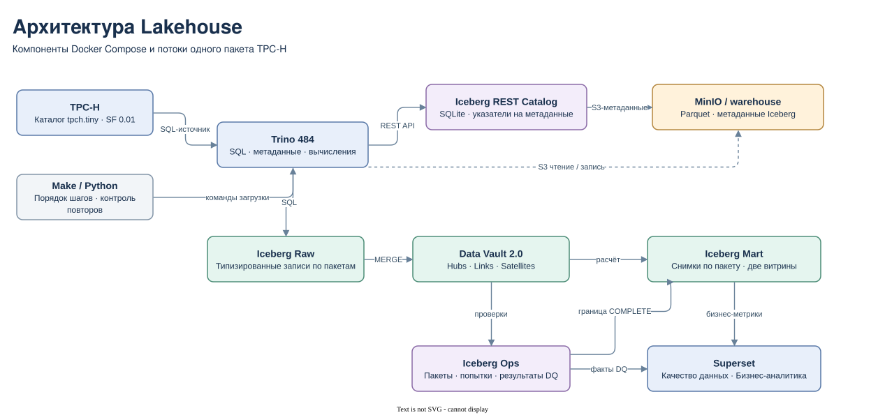
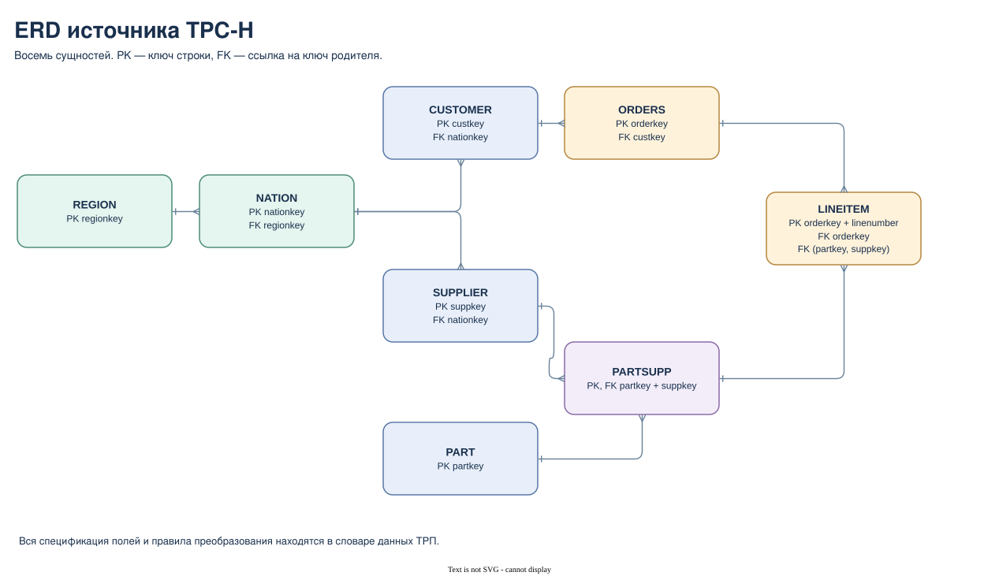
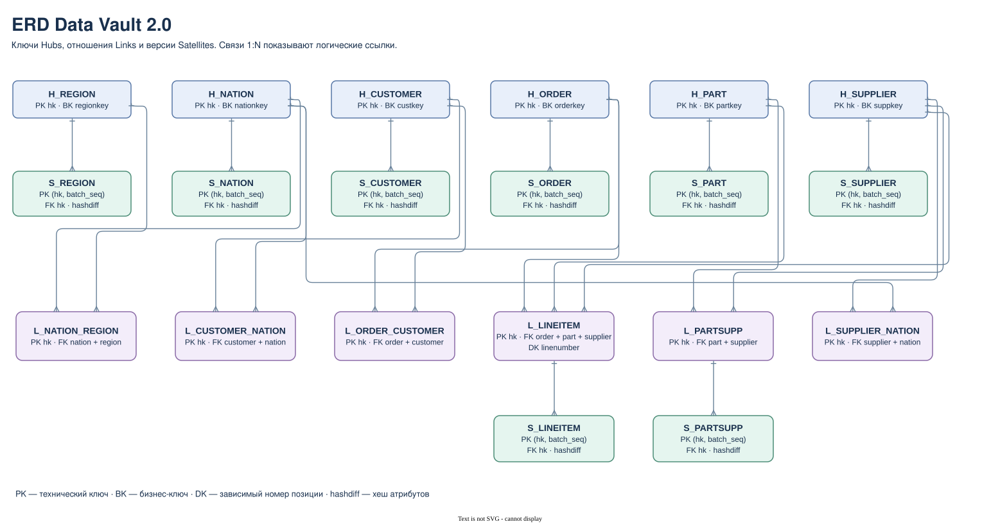
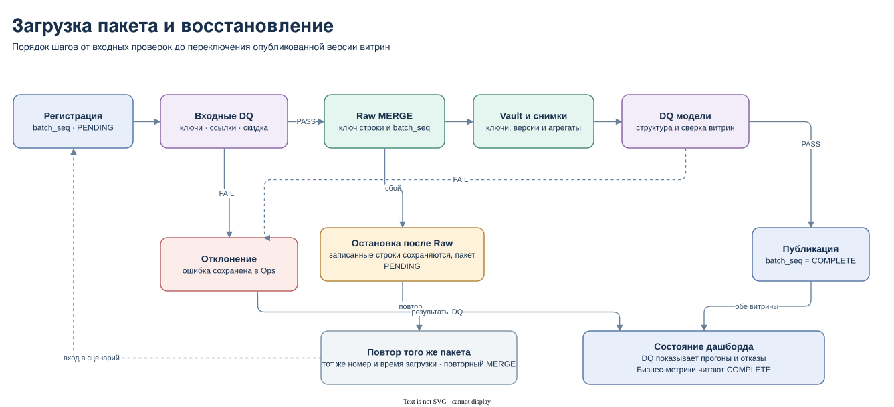

# Технический рабочий проект Lakehouse

Trino выполняет SQL над сырыми данными, центральной моделью Data Vault 2.0 и витринами. Iceberg REST Catalog хранит указатели на текущие метаданные в SQLite. MinIO хранит Parquet, JSON метаданных и манифесты. Superset запрашивает витрины и технические результаты DQ через Trino.

## Компоненты и интерфейсы

[Редактируемый исходник архитектуры](diagrams/architecture.drawio)

| Компонент | Интерфейс | Состояние |
|---|---|---|
| Trino 484 | SQL CLI и HTTP API, внутренний адрес `trino:8080` | Каталоги `tpch` и `iceberg` |
| Iceberg REST Fixture 1.10.1 | REST `rest:8181` | SQLite в томе `rest_data` |
| MinIO и mc | S3 API `minio:9000`, отдельная консоль | Приватный бакет `warehouse` в томе `minio_data` |
| Python и Make | Команды `bootstrap`, `load`, `dq`, `demo` и пошаговые фазы | Блокировка процесса на Compose-проект, SQL-шаблоны и аудит в Iceberg |
| Superset 6.1.0 | HTTP UI, SQLAlchemy URI `trino://analyst@trino:8080/iceberg` | SQLite в томе `superset_data`, один дашборд и три набора данных |

Хостовые порты привязаны к loopback. Сервисы используют имена Compose, поэтому проект приёмки можно запустить с отдельными томами и портами. Профиль `bi` позволяет выполнить загрузку и DQ без Superset. Версии компонентов и параметры указаны в [руководстве по развёртыванию](deployment.md).

## Логическая и физическая модели

[Редактируемый ERD источника](diagrams/tpch-erd.drawio) · [Полевая модель и маппинг](data-model.md)

Схема `stage` типизирует источник, формирует пакеты и предоставляет представления для расчёта кандидатов. `raw` хранит восемь типизированных событийных наборов по номеру пакета и исходному ключу. Таблицы Raw, Vault и Ops — Iceberg v2 с Parquet. На объёме SF 0.01 таблицы создаются без физического разбиения по секциям. `mart` содержит два версионированных снимка агрегатов в Iceberg и два опубликованных SQL-представления над ними. Ключ снимка включает номер пакета и измерения витрины. Повторное чтение витрин после сбоя использует последний номер пакета со статусом `COMPLETE`.

[Редактируемый ERD Data Vault 2.0](diagrams/data-vault-erd.drawio)

| Тип | Объекты | Гранулярность и версия |
|---|---|---|
| Hubs | `h_region`, `h_nation`, `h_supplier`, `h_customer`, `h_part`, `h_order` | Одна запись на исходный бизнес-ключ. Фиксируются время и источник первой записи |
| Links | `l_nation_region`, `l_supplier_nation`, `l_customer_nation`, `l_order_customer`, `l_partsupp`, `l_lineitem` | Одна запись на комбинацию ролей. Позиция содержит родительский заказ, зависимый номер позиции и роли товара и поставщика |
| Satellites | Сателлиты шести Hubs и двух транзакционных Links `l_partsupp`, `l_lineitem` | Одна отличающаяся версия атрибутов родителя в пакете. Ключ строки — `(hk, batch_seq)` |

Хеш входных значений вычисляется как SHA-256 от JSON-массива строковых представлений. Первый элемент — пространство имени объекта, затем идут значения в фиксированном порядке. JSON сохраняет границы элементов и различает NULL и пустую строку. Числа и ставки сначала приводятся к фиксированным SQL-типам. Технические поля не участвуют в `hashdiff`. Актуальная версия позиции — запись с максимальным `batch_seq`, который не превышает номер рассматриваемого пакета. В демонстрации отношения и остальные атрибуты сохраняются, изменяется только скидка позиции.

## Загрузка, контроль и восстановление

[Редактируемая последовательность](diagrams/load-sequence.drawio)

1. Зарегистрировать пакет и сохранить неизменное время загрузки. Применить входные DQ к типизированному представлению. Сохранить каждый результат с ключом `run_id, phase, rule_id, object_name`.
2. Записать Raw по ключу строки и пакета. Записать Hubs и Links по хеш-ключам. В сателлит вставить новую версию, если `hashdiff` отличается от предыдущего. Рассчитать обе витрины и записать их снимки по ключу группы и пакету.
3. Сравнить Raw с входом, проверить ключи и ссылки Vault, число версий и симметрическую разницу групп витрин с независимым расчётом по Raw.
4. Только после проверок изменить статус пакета на `COMPLETE`. Дашборд качества читает факты DQ независимо от публикации. Ошибочный вход не проходит в Raw, а проверка производных данных удерживает пакет в `PENDING`.

Коммиты Iceberg выполняются на уровне отдельных таблиц. Незавершённый пакет может содержать частично записанные строки. Публикация меняет одну запись управления и задаёт общую границу видимости для обеих витрин. При повторе с новым идентификатором попытки сохраняется её собственная история DQ. При повторе того же ручного шага факты попытки с тем же ключом не дублируются. Сверки DQ модели разбиты на группы, чтобы план Trino укладывался в лимит стадий. Для SQLite задано ожидание блокировки. При неопределённом результате коммита оркестратор ограниченно повторяет идемпотентную фазу.

| Код правила | Что измеряет |
|---|---|
| `KEY_NULL`, `KEY_DUPLICATE` | Строки с отсутствующим ключом и группы дублирующихся ключей во входе |
| `INPUT_FK` | Строки с отсутствующим исходным родителем |
| `INPUT_COUNT`, `RAW_COUNT` | Сравнение количества строк в источнике, входе и Raw по пакету |
| `DISCOUNT_RANGE` | Позиции со скидкой вне [0,1] или с NULL |
| `VAULT_KEY_DUPLICATE`, `VAULT_FK` | Дубли ключей и ссылки на отсутствующий родительский объект Vault |
| `SAT_VERSION_COUNT` | Число ожидаемых версий сателлита по пакету |
| `MART_RECONCILE` | Число строк в симметрической разнице групп расчётов из Vault и Raw |

## Каталог витрин и метрик

| Витрина | Группа | Смысл показателей |
|---|---|---|
| `mart.sales_by_region` | Месяц заказа и регион **клиента** | Число уникальных заказов, число строк заказов, сумма `extendedprice` и сумма `extendedprice × (1 − discount)`. Сравнение по регионам ведётся по стоимости позиций без налога |
| `mart.shipping_by_mode` | Месяц фактической отгрузки и способ доставки | Отгруженные позиции с заполненной `shipdate`, позиции с `shipdate > commitdate`, доля запоздалых позиций. Для выбора нескольких месяцев суммируются числитель и знаменатель |

Дашборд использует опубликованные витрины для вкладки «Бизнес-аналитика» и `ops.dq_results` для вкладки «Качество данных». Период, регион и способ доставки отфильтровывают соответствующие бизнес-графики. Запуск, правило и статус DQ влияют на сводку и детали качества.

## Зафиксированные решения

| Решение | Рассмотренные варианты | Причина и последствие |
|---|---|---|
| Детерминированный `tpch.tiny` | Коннектор Trino или выгрузка через отдельный генератор | Для повторов достаточно одного Compose-стенда. Фиксируем версию Trino и порядок выбора изменяемой позиции |
| Транзакционный Link позиции | Отдельный Hub позиции или Link заказа с зависимым номером | Номер позиции имеет смысл в контексте заказа. История скидки отделена от отношений |
| Публикация по статусу пакета | Чтение последней записанной строки или граница COMPLETE | Частичный commit Iceberg остаётся доступен для восстановления. Витрины переключаются после DQ |
| Материализация снимков | Пересчёт Vault каждым графиком или один расчёт при загрузке | Выбран расчёт при загрузке. Superset выполняет простые запросы к опубликованным агрегатам. DQ сверяет записанный снимок с независимым Raw до публикации |
| Две вкладки одного дашборда | Две независимые панели или один дашборд | Проверяющий может сопоставить бизнес-цифры со статусом загрузки. Наборы данных и фильтры разделены по задачам |
